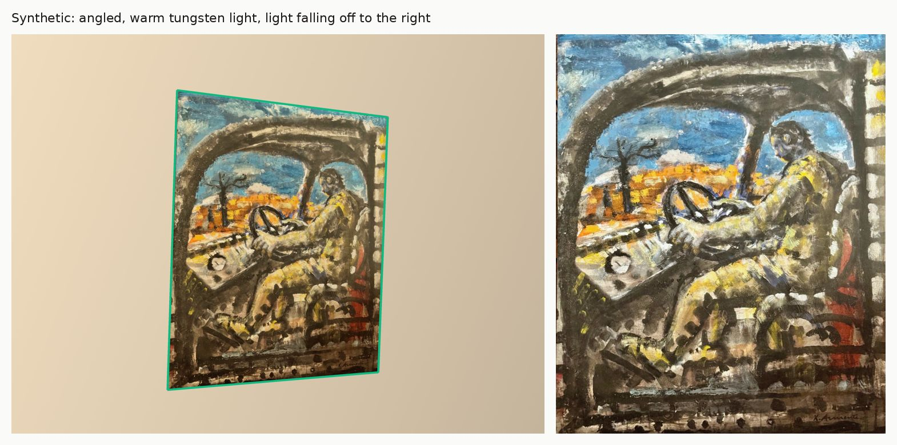
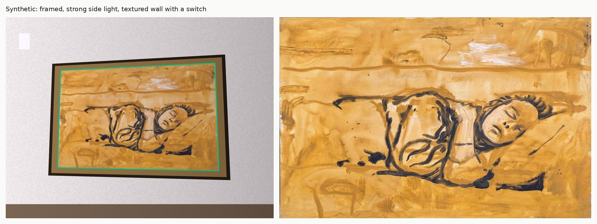
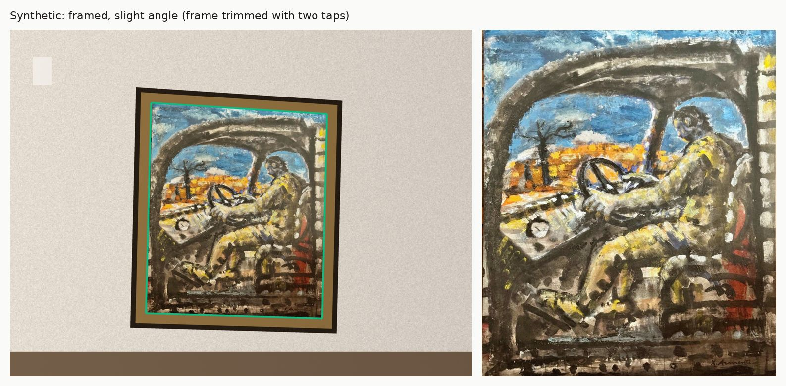
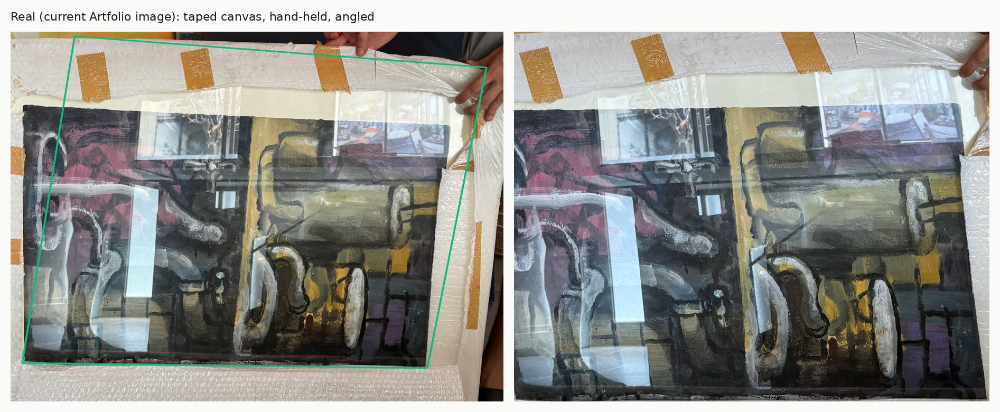
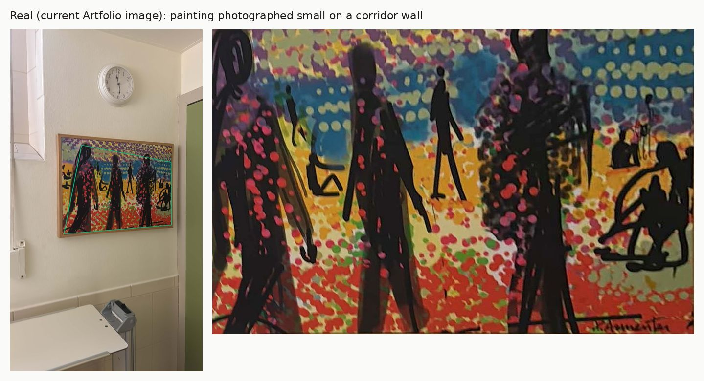
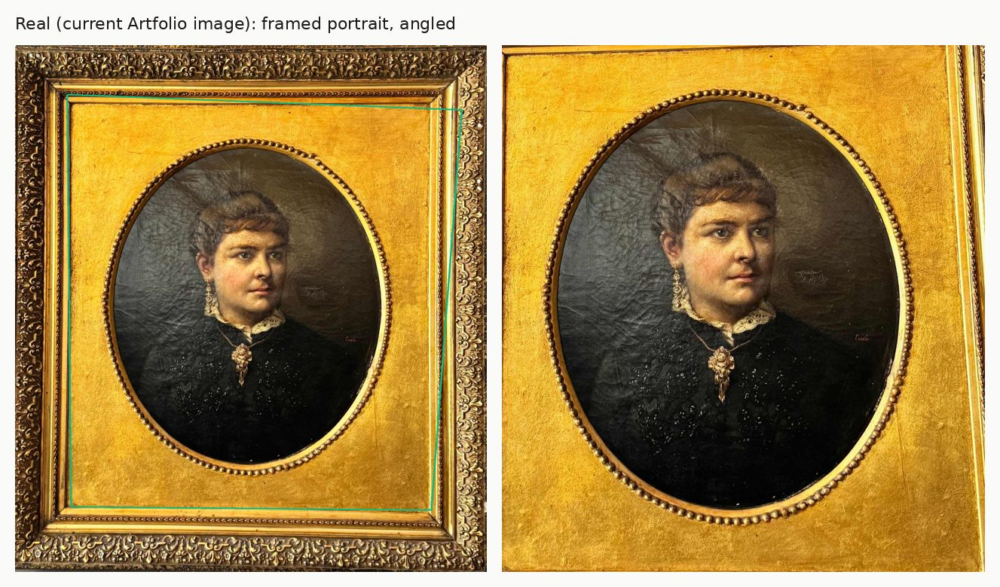

# Photographing paintings into Artfolio — options and recommendation

Date: 2026-11-22. Branch: `claude/artfolio-photo-capture`. Status: exploration + working prototype.

## The goal

Xano stands in front of a painting with his phone and, in under a minute, gets a
documentation-grade image into the right work in Artfolio: square-on, cropped to
the canvas edge, neutral colour, even exposure, sharp, ≥ 2000 px on the long
side. The site (xanoarmenter.com) picks it up within a minute because it reads
the first image of each work live from Artfolio.

"Portfolio level" here means *documentation*, not *beautification*: no
generative clean-up, no saturation boost. Every correction must be explainable
and reversible, and the untouched original is always kept.

## Options

### 1. Where the photo is taken

| Option | Pros | Cons |
|---|---|---|
| **A. Guided camera page inside Artfolio** (web, add-to-home-screen) | Live outline of the painting, level indicator, glare and distance hints, lands straight in the right work | Browser video frames are lower resolution than the native camera on some phones (iOS Safari: usually 1920–4032 px depending on model) |
| B. Native camera app, then upload | Full sensor resolution, HDR, best low-light | No guidance; the artist has to find the file and the work afterwards |
| C. Native iOS/Android app | Best camera control (RAW, fixed white balance, exposure lock) | App-store work, two codebases, overkill for 95 works |

**Pick A with B as a built-in fallback**: the guided page has a "Phone camera"
button that opens the native camera (`<input capture>`) and returns the full
resolution file into the same review/correct flow. On Chrome/Android the guided
shutter already uses `ImageCapture.takePhoto()`, which is full resolution.

### 2. Where the correction runs

| | **In the browser (OpenCV.js)** | Server function (Supabase Edge / Vercel) + classic CV | Server + image model (generative clean-up) |
|---|---|---|---|
| Corner detection, deskew | Same algorithms (OpenCV), runs on the phone | Same | Models are good at segmentation, but… |
| Colour faithfulness | Deterministic, measured from the wall | Same | **Risky**: models re-render texture and colour. Not acceptable for an art archive master. |
| Live feedback while framing | **Yes** (detection at ~5–10 fps on a 320 px frame) | No (round-trip per frame) | No |
| Speed for one photo | 1–3 s on a recent phone | 2–6 s incl. upload of a 5–10 MB original | 5–30 s |
| Cost | €0 | Small, but Edge Functions have a 2 s CPU limit, too tight for 12 MP warps; Vercel needs `sharp`/OpenCV native builds | Per image API cost |
| Offline / bad signal in the studio | Works; upload can wait | Needs signal | Needs signal |
| Download size | ~10 MB OpenCV once, only on the camera page, then cached | none | none |

**Pick in-browser.** The server adds cost and latency without improving the
result, and it can't give live framing feedback. A generative model is the wrong
tool for the master image; it is fine for an optional *wall mock-up* later (see
"Next").

### 3. How it gets into Artfolio

* **Attach to an existing work**: pick from a list that puts works *without a
  photo* first, or **scan the QR label** on the back. The QR format is owned by
  `claude/artfolio-qr`: `https://xanoarmenter.com/qr/<inventory number>` (e.g.
  `XA-0001`; `xa-1` and `XA1` are accepted too). The scanner only reads the
  inventory number out of that URL and looks it up in Artfolio; it also accepts
  Artfolio's own piece URLs.
* **New work from the photo**: title, year, width × height, medium quick-filled
  (year defaults to this year; the measured proportions pre-fill height from the
  width you type).
* **"Make this the main image"** (on by default) moves the new photo to position
  0, which is what the website shows. Existing images are never deleted or
  overwritten; they move down one place.
* **The original is kept** next to the corrected one in Storage
  (`<artist>/<piece>/<id>_original.jpg`), together with the corner points and
  colour settings, so the correction can be redone later.

## What the prototype does

Route: `/a/<artist>/capture` (menu: **Photograph**), or **📷 Photograph** on a
work's page (goes straight to that work). A no-login sandbox at
`/capture/try` runs the same camera + correction and just downloads the result,
for trying it out without touching data.

1. **Pick the work** (list, search, "needs photo" first, QR scan) or "New work".
2. **Camera**: full-screen view with
   * live outline of the detected painting (green when steady and well framed),
   * a **level bubble** from the orientation sensor (works for a painting on the
     wall — phone upright — or flat on the floor — phone face-down),
   * hints: *move closer*, *whole painting in view*, *hold still*,
     *glare on the painting — step sideways or move the light*,
   * shutter (full resolution where the browser allows), **Phone camera**
     (native app) and **Library** buttons.
3. **Corners**: the four detected corners, draggable with a magnifier for
   pixel-exact placement; a **frame inset** slider trims a visible frame or
   stretcher edge.
4. **Correct** (all deterministic, on the phone):
   * perspective warp (OpenCV `warpPerspective`, Lanczos), output proportions
     from the work's **recorded size** when known, otherwise estimated from the
     quad with the camera-geometry method (Zhang & He), not the naive edge
     average;
   * **white balance from the wall** around the painting (assumed neutral), or
     tap a neutral point, or off;
   * **even out lighting**: fits the light fall-off measured on the wall ring
     and divides it out (only when the gradient is > 4 %, capped at ±25 %);
   * exposure: sets the white point from the 99.5th percentile, in linear light,
     gain-limited; a manual ±EV slider overrides;
   * light sharpening after resampling;
   * **Trim frame edge**: flattens the current outline and finds the next
     straight, even edge inside it (one tap per frame band); the wall is still
     sampled outside the original outline, so trimming doesn't lose the white
     balance;
   * output: long side up to 4000 px (never upscaled more than 10 %), JPEG 92;
   * checks shown before saving: resolution (≥ 2000 px), sharpness
     (Laplacian variance), glare (clipped highlights inside the canvas),
     proportions vs. recorded size (and auto-rotates 90° if it matches turned).
5. **Save**: uploads corrected master + 640 px thumbnail + original, inserts the
   `piece_images` row with `width`/`height` (the website needs them), optionally
   makes it the main image, then offers **Next work**.

## Database / storage changes (not applied — Mike to approve)

`supabase/migrations/20261122000000_piece_image_capture.sql`:

```sql
alter table public.piece_images
  add column original_path text,   -- untouched phone photo
  add column capture jsonb;        -- corners, size, colour gains, device, app version
```

No storage-policy change is needed: originals live in the same
`<artist_id>/<piece_id>/` folder, so the existing editor/member policies cover
them. The bucket limit (25 MB, JPEG/PNG/WebP) is already enough.

**The prototype works without the migration**: it always stores the original at
the sibling path `<id>_original.jpg`; if the columns don't exist yet it retries
the insert without them. After the migration it also records them in the row.
`deletePieceImage` now removes the `_original` file too.

## Before / after

Run through the exact in-app pipeline (`tests/capture/bench.mjs`, headless
Chromium). Left: input with the detected outline; right: what gets saved.

| | |
|---|---|
|  | Synthetic 12 MP phone shot: angled, warm light, fall-off. Corners found to within ~10 px; colour cast measured on the wall (R ×0.84, B ×1.39, i.e. the applied cast); 20 % fall-off evened out; 2059 × 2498 px. |
|  | Framed, strong side light, textured wall with a switch. Two taps on **Trim frame edge** land on the canvas; the wall outside the frame still drives the colour; 35 % fall-off evened out. |
|  | Framed, slight angle, same treatment. |
|  | **Real, current Artfolio image** of *La Reserva*: taped, hand-held, angled. Squared up and colour fixed, but the source is only 1600 px, so the check says "retake". |
|  | **Real**, *Beach*: photographed small on a corridor wall. The crop is right, but at 985 px it's a "retake" (exactly the case the guided camera's *Move closer* hint prevents). The wall is too yellow to trust, so colour is left as shot and the user is told. |
|  | **Real**, *Las abuelas*: framed and angled. Deskewed and one frame band trimmed. |

What the existing images show: Artfolio only holds 1600 px copies (the AA
import), so re-correcting old photos can fix geometry but never reaches
portfolio resolution. The win is re-photographing with the guided camera.

Speed (desktop Chromium; expect 2–3× on a phone): detection 0.3–0.6 s on a
12 MP photo, full correction 1.1–1.7 s; live detection on the 360 px preview
runs every 140 ms. Previews render at 1400 px so the sliders stay quick; the
full-size image is made once, on **Next**.

## How it was tested

* `tests/capture/bench.mjs` + `bench.html`: runs the pipeline on any photos and
  writes the results (used for the images above).
* `tests/capture/e2e-try.mjs`: the no-login sandbox on an emulated Pixel 7 with
  a fake camera showing a painting on a wall: live outline goes green, shutter,
  correct, drag a corner (magnifier), download.
* `tests/capture/e2e-app.mjs`: logged in as a throwaway test user on a
  throwaway artist (`zz-capture-test`, deleted afterwards), against the real
  Supabase project:
  1. typed QR label `https://xanoarmenter.com/qr/zz-2` → opens ZZ-0002;
  2. existing work with an old photo → guided shot → saved as main; the old
     image stayed, at position 1;
  3. **New work from a photo** (library), two frame trims, width typed, height
     suggested from the photo (141.3) → work ZZ-0003 created with its image;
  4. a 12 MP file via **Phone camera** → saved; the proportions check flagged
     the mismatch with the recorded size.
  Every image row had `width`/`height`; each save left
  `<id>.jpg`, `<id>_thumb.jpg` and `<id>_original.jpg` in Storage.
* Not tested on a real phone yet (needs Mike/Xano): real iOS/Android cameras,
  the level (motion sensor), BarcodeDetector vs jsQR, memory on older phones.

## Next (not in the prototype)

* **Wall mock-up**: composite the corrected image on a neutral wall at true
  scale (from the recorded size) with a soft shadow, as a separate, clearly
  labelled image. Deterministic canvas version is a day's work; an image model
  is acceptable here because it's not the documentation master.
* **Re-process from original** button on the piece page (needs the migration).
* **Colour checker** support: if a ColorChecker card is in the shot, use it
  instead of the wall for white balance and a full colour matrix.
* **Offline queue**: save to IndexedDB in the studio, upload when back on Wi-Fi.
* **Detail shots** (signature, texture) as extra non-main images, skipping the
  deskew.
