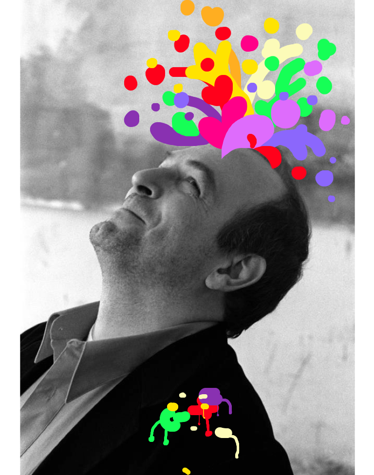
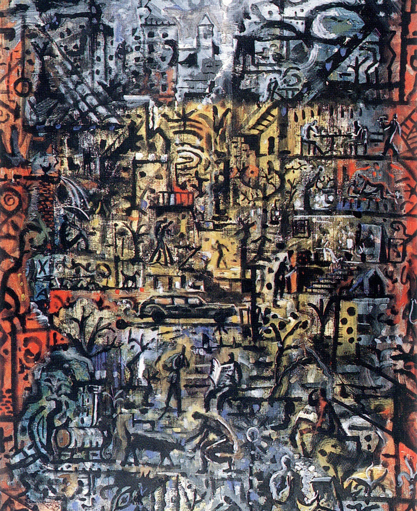
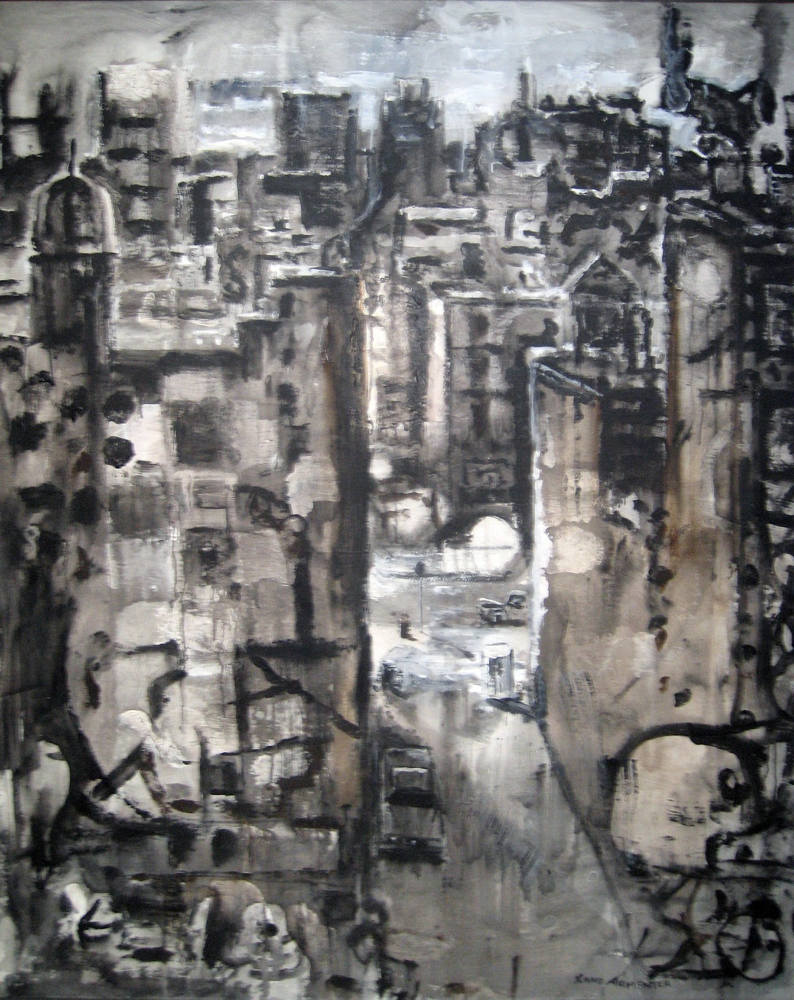
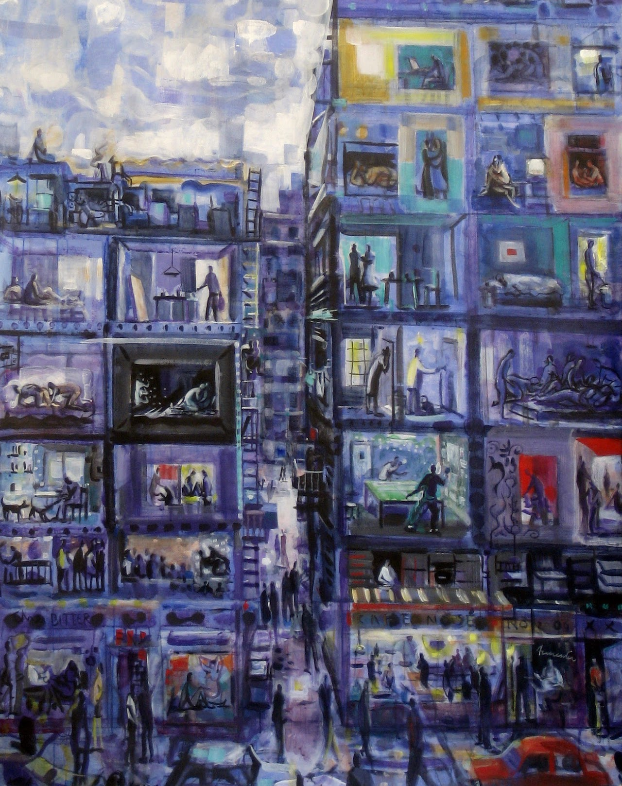
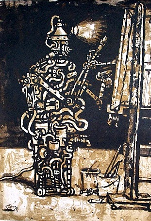

# Xano Armenter — Live Google Site (source of truth)

Captured 2026-11-15 from https://sites.google.com/view/xanoarmenter/

The site has three pages: **Home**, **About**, **Work**. Home and About have the same content.
Raw HTML for each page is in `raw/`, and the images are in `images/`.

Instagram: [@xano_armenter](https://www.instagram.com/xano_armenter/)

---

## Home / About

### Artist Statement

Creating art has been my constant since childhood. My drive to capture and reinterpret visual impressions has always been deeply rooted in my way of seeing and experiencing the world. From an early age, I became fascinated by how perception shapes reality. This naturally led me to express this visually—translating impressions onto the canvas and exploring the interplay between form, light, and emotion.

I began my studies in Barcelona, learning under esteemed art and design teachers known for their experimental approaches. Later, I moved to New York, where I immersed myself in its dynamic and provocative art scene, absorbing its raw energy and spirit of experimentation.

My work navigates between chaos and structure, spontaneity and precision. Though I paint and design for myself, I invite the viewer to engage as a participant in this experience. To me, painting is like a joyous visual chess problem—one that challenges both artist and observer to question and decipher the nature of art as a reflection of the external world, much like a window into our own subjectivity.

**Xano Armenter is currently represented by KBH Fine Arts Gallery.**

### Individual Exhibitions

- **2020** — American Paintings New York + Los Angeles 1985-1999. Centre Cultural Terrassa, Terrassa, Barcelona.
- **2019** — Seeing beneath the walls. Castell de Benedormiens. Castell D´Aro. Girona.
- **2017** — Galeria Àmbit, Barcelona.
- **2014** — Galeria Àmbit, Barcelona.
- **2011** — Blanc i Negre (Black and White). Galeria Àmbit. Barcelona.
- **2010** — Art & Design. Barcelona.
- **2008** — Galeria Àmbit, Barcelona.
  - The heartbeat of the earth. Convent of San Salvador. Horta de Sant Joan, Tarragona.
  - Paintings for the Hotel Santuari del Sant Crist de Balaguer.
- **2006** — Other Realities. 4Spais d'Art, Balaguer, Lleida.
- **2005** — Galeria Àmbit. Barcelona.
- **2003** — Retrovisor 93-03, Barcelona, Galeria Àmbit.
- **2002** — Paraisos perdidos, Barcelona, Sala Parés.
- **2001** — Compact Art, Barcelona, Rrose Selavy.
  - New Art, Barcelona.
- **1998** — Galeria Trama. Barcelona.
  - 100 days, Círculo de Bellas Artes. Madrid.
  - ARCO, Trama Gallery. Madrid.
- **1997** — Los Angeles, 1551 Gallery.
  - New Art, Galeria Trama. Barcelona.
- **1996** — Galería Trama, Barcelona.
- **1995** — Galería Trama, Barcelona.
- **1994** — ARCO, Galería Trama. Madrid.
  - Filters. Galería Trama, Barcelona.
- **1993** — Commenoz Gallery. Miami.
- **1992** — Sala Parés. Barcelona.
- **1991** — Francesc Cullel, Olot, Girona.
  - Por mutuo acuerdo. Sala Vinçon, Barcelona.
- **1990** — Sala Parès. Barcelona.
  - Catalunya Gallery. Tokyo, Japan.
- **1989** — Galería Bisart. Palma Mallorca.
- **1988** — L'Hipodrome, Lille, France.
- **1987** — Galería Rene Metras, Barcelona.
- **1986** — The Big Picture. Sala Vinçon, Barcelona.
  - Limbo Lounge Gallery, New York.
- **1983** — Galeria Sa Llumenera, Cadaqués, Girona.
  - Escola d´Art I Disseny Eina, Barcelona.
- **1978** — Taller Picasso, Barcelona.
- **1975** — Taller Picasso, Barcelona.

### Group Exhibitions

- **2024** — Il·luminats. Mater: Casa Museo, Barcelona.
- **2023** — Ultralocal. Mater: Casa Museo, Barcelona.
- **2022** — Galeria Ola, Barcelona.
- **2014** — Record´Art Cadaques. Several Galleries. Cadaques, Girona.
- **2011** — Arte Navas. Las Navas del Marqués. Ávila.
- **2009** — I Have A Dream. International exhibition. New York, and many other cities.
- **2008** — Private Life (Joseph Ma Civil collection). CDAN, Huesca.
- **2007** — Concor, Knud Hartung. Munich.
- **2006** — Maravillas. Pilar Riberaygua, Galeria d'Art. La Vella, Andorra.
- **2002** — Dualitats. Sala Parés. Barcelona.
- **2001** — La Bib Collection. La Santa Projectos Culturales, Barcelona.
- **2000** — EURO-World. Frankfurt, Germany.
- **1996** — essencies, Col·lecció Ernesto Omedes. Barcelona.
- **1994** — La Màgia de la Ciutat. La Capsa Màgica. Fundació "la Caixa".
  - ARCO. Galeria Trama. Madrid.
- **1993** — LA Exhibition, Municipal Art Gallery. Hollywood. Los Angeles.
- **1992** — A Barcelona, Sala Parés. Barcelona.
  - Galeria Pèrgamon, Barcelona.
- **1991** — Line, Space & Expression, Commenoz Gallery, Miami.
- **1990** — Catalonia 90´s. The Armory. New York.
  - Lyon & Barcelona, Galerie Michel Guinle, Lyon. France.
  - Art Expo, Toquio, Japan.
  - Art Fair, Chicago.
- **1989** — 5 Artistes d´Eina. Sala Parés, Barcelona.
  - Bowery Papers. Galeria Pergamon, Barcelona.
  - Interarte, Valencia.
  - Catalan Latest Art Exhibition, Catalunya Gallery. Tokio.
  - Planeta esport. Barcelona.
- **1988** — Supermercart. Sala Vinçon, Barcelona.
- **1987** — Tres al Port. Metrònom, Barcelona.
  - Marinas, Otto Zutz, Barcelona.
- **1986** — Supermercart. American Prints. Barcelona.
- **1985** — Artitude. Limbo Lounge Gallery. New York.
- **1984** — African Abstracts. Danceteria, New York.
  - Benefit Show. Limbo Lounge. New York.
- **1983** — Post-Puritanism. Plexus, New York.
- **1979** — Amnistia Internacional. Fundació Miró. Barcelona.
- **1975** — XIV Premi Internacional Dibuix Joan Miró. Barcelona.

### Permanents

- La Bib Collection. La Santa Projectos Culturales, Barcelona.
- 30 Eines 1967-1997. Exposició Fons d'art. Fundació Eina. Barcelona.

### Commercial and Public Commissions

- **2022** — Suite of 60 paintings for A Palacios. Corullon. Leon.
- **2021** — Sun & Moon. Two large-scale paintings for Hospital Clinic, Barcelona.
- **2017** — Pintures per l´Hotel Seminari de la Seu d´Urgell. Lleida.
- **2008** — My Town, a suite of 32 paintings for Hotel Santuari del Sant Crist de Balaguer.
- **2006** — Paintings for the wine labels of A. Palacios (Petalos).
- **2005** — Limbo, a carpet for the Nani Marquina collection.
- **1999** — 7 True Fresco Murals for Hotel Juan Carlos I.
- **1998** — Acid-engraved glass wall for the Triangle, Barcelona.
- **1992** — Post stamps collection for the Olympic Games Barcelona 92.
- **1987** — Catalan Sense, for BCD and Bloomingdales. Traveling exhibit with Perico Pastor, at Boston, New York & Boca Raton, Florida.

---

## Work

### 1980-1992 (New York City)

| Image | Title | Details |
|---|---|---|
|  | **House of Feelings**, 1989 | Acrylic on canvas · 300 x 200 cm |
|  | **Last Painting of New York** | (no details given on site) |
|  | **Sex in the City** | (no details given on site) |
|  | **Automat**, 1991 | Engraving on paper · 65 x 84 cm |

---

### Notes on the source text

Small typos on the live site were tidied here: "Sala Vinc on" / "Sala Vicon ç" → "Sala Vinçon". Everything else is as written, including Spanish/Catalan spellings and "Toquio" / "Tokio". The raw HTML in `raw/` has the original exactly.
